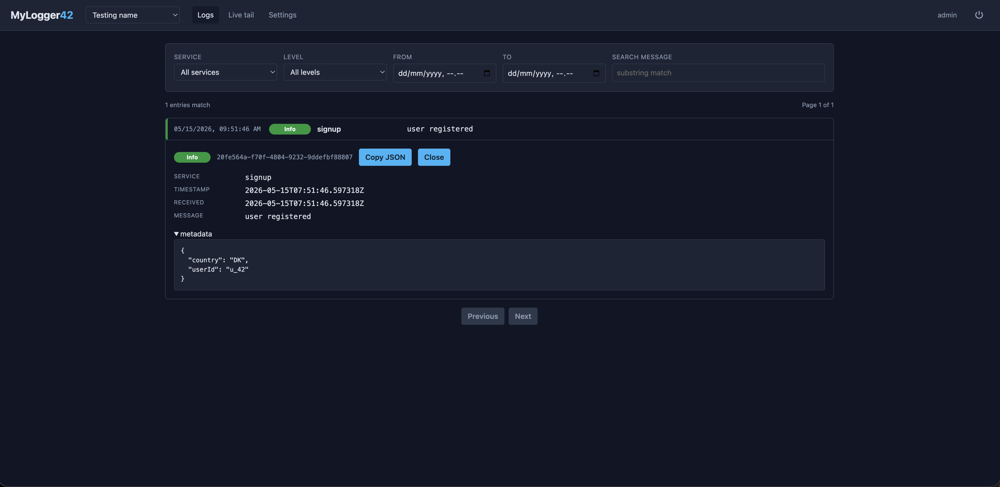
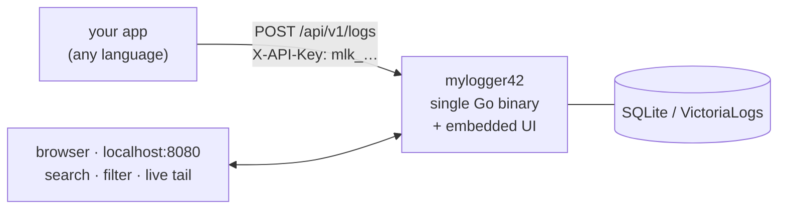
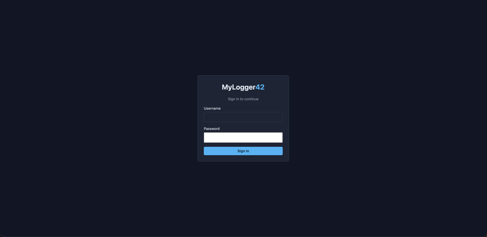
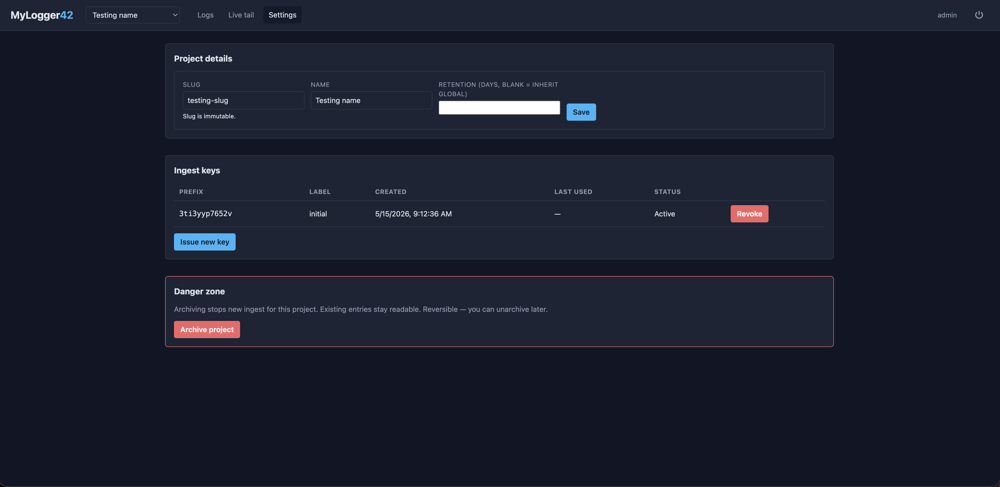

<div align="center">


# MyLogger42

**A small, self-hosted logging server.** Your apps `POST` JSON events to it,
and you read them back in a browser — search, filter, or watch them stream in live.

[](https://github.com/MyLogger42/MyLogger42/actions/workflows/ci.yml)
[](go.mod)
[](LICENSE)



</div>

---

## Features

- ⚡ **Single static binary** — the React UI is embedded, SQLite is built in. Nothing else to serve.
- 🗂 **Multi-project** — one logical bucket per app, each with its own ingest keys and retention window.
- 📡 **Live tail** — WebSocket stream, filter by service and level, watch events arrive in real time.
- 🔍 **Search & filter** — service, level, time range, message substring; metadata shown per entry.
- 📊 **Activity panel** — level-over-time histogram, per-level totals, and a most-repeated-messages ranking; every panel is a filter control.
- 🔐 **Locked down** — bcrypt admin login, rate-limited auth, HMAC-fingerprinted ingest keys, per-key revocation.
- ♻️ **Retention** — background purge worker, per-project overrides, `0` = keep forever.
- 🐳 **One-command deploy** — `docker compose up`, secrets auto-generated on first boot.
- 🚀 **VictoriaLogs optional** — SQLite by default; switch the log engine with two env vars when one file stops being enough.

---

## Quick start (Docker)

```sh
git clone https://github.com/MyLogger42/MyLogger42.git && cd MyLogger42
printf 'ADMIN_USERNAME=admin\nADMIN_PASSWORD=change-me\n' > .env
docker compose up -d
```

Open `http://localhost:8080/`, log in, hit **+ New project**, and copy
the ingest key from the modal. Then send your first event:

```sh
curl -X POST http://localhost:8080/api/v1/logs \
  -H "X-API-Key: mlk_<your-key>" \
  -H "Content-Type: application/json" \
  -d '{"service":"signup","level":"Info","message":"user registered","metadata":{"userId":"u_42"}}'
```

Reload the project's **Logs** page — your entry is there. Open **Live
tail** in another tab and POST again — you'll see it arrive in real
time. That's the whole loop.

No Go or Node toolchain needed — the image builds everything
internally. Prefer running the binary directly? See
[Run from source](#run-from-source).

### Starting with VictoriaLogs instead of SQLite

Same three commands, two extra lines in `.env`. Only do this if you
already know you want it — SQLite handles far more than most
deployments need, and the [comparison
below](#switching-the-log-engine-to-victorialogs) lists what changes.

```sh
git clone https://github.com/MyLogger42/MyLogger42.git && cd MyLogger42
cat > .env <<'EOF'
ADMIN_USERNAME=admin
ADMIN_PASSWORD=change-me
DB_DRIVER=victorialogs
COMPOSE_PROFILES=victorialogs
EOF
docker compose up -d
```

`DB_DRIVER` tells the server where to put logs; `COMPOSE_PROFILES`
tells Compose to actually start the VictoriaLogs container. Both live in
`.env`, so every later `docker compose` command — `logs`, `down`,
`restart` — works with no extra flags.

---

## How it works



### Concepts in 60 seconds

You need to know three things to use MyLogger42 productively.

- **Project.** A logical bucket of log entries — typically one per app
  or service group. Each project has its own ingest keys and its own
  retention window.
- **Ingest key.** A long random string of the form
  `mlk_<prefix>_<secret>` that an HTTP client sends in the
  `X-API-Key` header. Each key belongs to exactly one project. You
  can have several per project (one per deploy / CI job / dev
  machine), and revoke any of them without affecting the others.
- **Admin user.** A single human login that has access to the web UI
  and can create / archive projects and issue / revoke keys. Read
  endpoints all require this login. Ingest endpoints do not — they
  only need a valid key.

---

## Sending events from your app

The wire format is one JSON document per request, or an array for
batch.

### Required fields

| Field     | Type   | Notes                                                                                  |
|-----------|--------|----------------------------------------------------------------------------------------|
| `service` | string | The component within the project that emitted the event (e.g. `"signup"`, `"worker"`). |
| `level`   | string | One of `Verbose`, `Debug`, `Info`, `Event`, `Warning`, `Error`, `Fatal`.               |
| `message` | string | Short human-readable line. Free text.                                                  |

### Optional fields

| Field        | Type    | Default                  | Notes                                                                                                                                                  |
|--------------|---------|--------------------------|--------------------------------------------------------------------------------------------------------------------------------------------------------|
| `timestamp`  | RFC3339 | server's receive time    | Use this if you're shipping batched / delayed events and want them to keep their original timestamp.                                                   |
| `metadata`   | object  | `{}`                     | Any JSON object — request IDs, user IDs, structured fields you'd want to filter on later. Stored as JSON; v2 doesn't index inside it but does show it. |

### Forbidden field

`project` — never include it. The project is determined by which
ingest key you use. A payload that includes a top-level `project`
field is rejected with `400 Bad Request` (this prevents apps from
accidentally writing into the wrong project).

### Single

```sh
curl -X POST http://localhost:8080/api/v1/logs \
  -H "X-API-Key: mlk_…" \
  -H "Content-Type: application/json" \
  -d '{"service":"signup","level":"Error","message":"db unreachable","metadata":{"err":"timeout"}}'
```

Returns `201 Created` with `{"id": "<uuid>"}`.

### Batch (up to 500 entries)

```sh
curl -X POST http://localhost:8080/api/v1/logs/batch \
  -H "X-API-Key: mlk_…" \
  -H "Content-Type: application/json" \
  -d '[
    {"service":"signup","level":"Info","message":"a"},
    {"service":"signup","level":"Info","message":"b"}
  ]'
```

Returns `201 Created` with `{"accepted": N}`. **Atomic**: if any
single entry is invalid, the entire batch is rejected with `400` and
none of the entries are written. The response body lists the failing
indices.

### Quick recipes

<details>
<summary><strong>JavaScript / Node fetch</strong></summary>

```js
await fetch('http://localhost:8080/api/v1/logs', {
  method: 'POST',
  headers: {
    'Content-Type': 'application/json',
    'X-API-Key': process.env.MYLOGGER42_KEY,
  },
  body: JSON.stringify({
    service: 'web',
    level:   'Error',
    message: err.message,
    metadata: { stack: err.stack, requestId: req.id },
  }),
});
```

</details>

<details>
<summary><strong>Python (requests)</strong></summary>

```py
import os, requests

requests.post(
    "http://localhost:8080/api/v1/logs",
    headers={"X-API-Key": os.environ["MYLOGGER42_KEY"]},
    json={
        "service": "ingest-worker",
        "level":   "Warning",
        "message": "retry queue backing up",
        "metadata": {"depth": 421},
    },
    timeout=2,
)
```

</details>

<details>
<summary><strong>Go (net/http)</strong></summary>

```go
body, _ := json.Marshal(map[string]any{
    "service": "billing",
    "level":   "Info",
    "message": "invoice issued",
    "metadata": map[string]any{"invoiceId": id},
})
req, _ := http.NewRequest("POST", "http://localhost:8080/api/v1/logs", bytes.NewReader(body))
req.Header.Set("X-API-Key", os.Getenv("MYLOGGER42_KEY"))
req.Header.Set("Content-Type", "application/json")
http.DefaultClient.Do(req)
```

</details>

---

## Using the UI

After logging in at `http://localhost:8080/` you land on **Projects**.
Pick one and you get three tabs:

### Logs (history)

Search and filter past entries. Filters:

- **Service** — dropdown populated from services seen in this project.
- **Level** — single level on the history page; the live-tail page
  has multi-select.
- **From / To** — datetime range.
- **Search** — substring match on `message`.

Above the list sits the **Activity** panel, all of it derived from the
same filter as the list:

- **Histogram** — entries per time bucket, stacked and coloured by
  level. Pick the bucket size (1m / 5m / 1h / 1d); hover a column for
  the per-level breakdown; **click a column to filter the list to that
  window**.
- **Level totals** — one chip per level with its count. Clicking a chip
  filters to that level; clicking it again clears the filter. The chips
  double as the histogram's legend.
- **Most repeated** — the ten noisiest identical
  (service, level, message) groups in the range, each with its count and
  the span it repeated over ("×482 over 3m"). Click a row to filter the
  list down to that message. This is where a service hammering the same
  error shows up as one line instead of 482.

Click any row to expand it — you'll see the full metadata JSON, the
exact RFC3339 timestamp, and the entry ID. Use Previous / Next to
page through results (50 per page).

Consecutive entries with an identical service, level and message are
folded into a single row with a `×N` badge; expand it to see the
individual entries. Matching is exact and adjacent-only, so nothing is
reordered and nothing that isn't literally the same message is hidden.
Repeats that are spread out over the range show up in **Most repeated**
instead. Live tail folds repeats the same way.

### Live tail

Opens a WebSocket and streams matching entries as they arrive. You
can:

- Filter by service and any combination of levels.
- **Connect / Disconnect** to pause and resume the stream.
- **Auto-scroll** off if you're reading older entries while new ones
  flow in.
- **Clear** to drop the buffer.

### Settings

Per-project settings:

- **Project details** — rename, change retention. Slug is permanent
  (it's in URLs and on every existing key).
- **Ingest keys** — table of all keys for this project. **Issue new
  key** opens a label prompt and shows the new key value once. Each
  row has a **Revoke** button; revoked keys stop authenticating
  immediately.
- **Danger zone** — archive (stops new ingest, keeps existing
  entries) or unarchive. Hard delete is CLI-only.

The project switcher in the top bar lets you jump between projects
while staying on whichever tab you were looking at.

<details>
<summary><strong>More screenshots</strong></summary>

| Login | Settings |
|-------|----------|
|  |  |

</details>

---

## Run from source

### 1. Build

```sh
make build
```

This builds the React UI and the Go binary, embeds the UI into the
binary, and writes the result to `bin/mylogger42`.

> Prerequisites: Go 1.22+, Node 20+, npm. SQLite is built in (no
> system library needed).

### 2. Bootstrap (one command)

```sh
./bin/mylogger42 admin init
```

Run this directly — `admin init` generates everything for you.

This walks you through everything in one go:

- Generates `KEY_PEPPER` and `SESSION_SECRET` (the two crypto secrets
  the server needs to start).
- Asks for the admin username and password (no echo on the password).
- Optionally creates a first project (default: skip — you can create
  projects from the web UI after logging in).
- Writes everything to `./.env` (mode `0600`, owner-only readable).

You'll see something like:

```
init: generated KEY_PEPPER
init: generated SESSION_SECRET
admin username: admin
admin password: ********
confirm:        ********
init: admin user configured
init: wrote .env
Create a first project now? [y/N] n

Next steps:
  1. Source the env and start the server:
       set -a; source .env; set +a
       ./bin/mylogger42
  2. Open http://localhost:8080/ and log in.
  3. Create a project + key when ready:
       ./bin/mylogger42 admin create-project <slug> <name>
     or use the Projects page in the UI.
```

### 3. Start the server

```sh
set -a; source .env; set +a
./bin/mylogger42
```

The binary serves the API and the UI on the same port (8080 by
default).

### 4. Log in and create a project

Open `http://localhost:8080/` in your browser, sign in with the admin
user you just created. If no projects exist yet you'll see an empty
state with a **+ New project** button — create one there, copy the
ingest key from the modal, and you're ready to send events.

---

## Running with Docker

The recommended way to self-host — see [Quick start](#quick-start-docker)
for the three commands. Details:

- `ADMIN_USERNAME` / `ADMIN_PASSWORD` are only used on **first boot**
  to seed the admin user. Once the database has a user record they are
  ignored on every subsequent start — the database is the source of
  truth.
- On first boot the container generates `KEY_PEPPER` and
  `SESSION_SECRET` and writes them to `/app/data/.secrets` inside the
  named volume. They persist across restarts and re-creates — rotating
  them invalidates all ingest keys and logs out all active sessions.
- Migrations apply automatically on startup.

Follow the logs with `docker compose logs -f mylogger42`. On a clean
first boot you should see lines like:

```
mylogger42: first boot — generating secrets
mylogger42 starting mylogger42 (driver=sqlite, port=8080, retention=30d)
mylogger42 admin: bootstrapped user "admin" from env vars
mylogger42 http listening on :8080
```

All `admin` subcommands work through `docker exec` — see the
[operations guide](docs/operations.md#admin-cli-via-docker).

### Data persistence

The SQLite database and the generated secrets file are stored on the
`mylogger42-data` named volume. The volume survives `docker compose
down` — only `docker compose down -v` removes it (taking your data
with it).

### Switching the log engine to VictoriaLogs

SQLite is the default and needs nothing else running. When log volume
outgrows it, move **only the logs** to [VictoriaLogs][vlogs] — a
purpose-built log engine with heavy compression and indexed search.
Users, projects and ingest keys stay in SQLite, so this is still a
two-container deployment with no database server to administer.

Two lines in `.env`:

```sh
DB_DRIVER=victorialogs      # the server sends logs to VictoriaLogs
COMPOSE_PROFILES=victorialogs  # Compose starts the vlogs container
```

Then the usual restart:

```sh
docker compose up -d
```

You need both. With `DB_DRIVER` alone the server pings a VictoriaLogs
that isn't there, exits (`storage unreachable`), and restart-loops; with
the profile alone you get a log engine nothing writes to.

Nothing else needs setting — `docker-compose.yml` already wires
`VLOGS_URL` and keeps `DB_DSN` on the same volume, so your users,
projects and keys carry over untouched.

Confirm which engine is live:

```sh
curl -s http://localhost:8080/api/v1/health
# {"status":"ok","storage":"victorialogs",...}
```

<details>
<summary>Prefer not to put <code>COMPOSE_PROFILES</code> in <code>.env</code>?</summary>

Pass the profile per command instead:

```sh
docker compose --profile victorialogs up -d
```

The catch is `up`: without the flag it brings up the server only and
silently skips vlogs, so after a `down` the server boots with nothing to
write to and restart-loops until you re-run it *with* the flag. Tearing
down is more forgiving — `stop` and `down` reach the vlogs container
either way (checked on Compose v2.39) — but `up` is the command you type
most, which is why the `.env` line above is less to remember.

</details>

The REST API and UI are identical in both modes. Three differences are
worth knowing before you switch:

| | SQLite | VictoriaLogs |
| :--- | :--- | :--- |
| `search=` matching | substring — `imeou` finds `timeout` | case-insensitive **phrase** — `imeou` does not |
| Per-project `retentionDays` | enforced | **not enforced** — the engine has one global window, set by `RETENTION_DAYS`. The UI flags the field. |
| Logs older than retention | stored | **silently discarded at ingest**, with a `201` still returned to the client |

That last one is a property of VictoriaLogs, not of this server: it
refuses entries whose timestamp predates `-retentionPeriod` and reports
the drop only in its own log. If you backfill old logs, raise
`RETENTION_DAYS` to cover the oldest timestamp you send.

Switching engines does not migrate existing logs — logs already in
SQLite stay there. Metadata (users, projects, keys) is untouched either
way, so you can switch back by removing `DB_DRIVER` and
`COMPOSE_PROFILES` from `.env` and running `docker compose up -d` again.

**Running from source instead of Docker?** There is no Compose profile
to activate, so point the binary at your own VictoriaLogs and set both
addresses yourself — `DB_DSN` still holds the metadata:

```sh
DB_DRIVER=victorialogs
VLOGS_URL=http://localhost:9428
DB_DSN=./data/mylogger42.db
```

[vlogs]: https://docs.victoriametrics.com/victorialogs/

---

## Running behind a TLS reverse proxy

**Required for internet-facing deployments.** Put Caddy / Nginx /
Traefik in front so traffic reaches the server over HTTPS.

`TRUST_FORWARDED_PROTO` is already set to `true` in
`docker-compose.yml`. The server honors `X-Forwarded-Proto: https`
when deciding whether to mark the session cookie `Secure`.

The server has a built-in login rate limiter (5 failed attempts per IP
per 15 minutes). When `TRUST_FORWARDED_PROTO=true` is set (as in
`docker-compose.yml`), it reads the real client IP from
`X-Forwarded-For`; otherwise it uses the connection's remote address.

Caddy minimal example (handles TLS automatically):

```
logs.example.com {
  reverse_proxy localhost:8080
}
```

If you are not using Docker, set `TRUST_FORWARDED_PROTO=true` in your
`.env` and ensure your firewall only allows traffic to port 8080 from
the proxy.

---

## Configuration reference (`.env`)

| Variable                | Required          | Default                  | Notes                                                                                                      |
|-------------------------|-------------------|--------------------------|------------------------------------------------------------------------------------------------------------|
| `KEY_PEPPER`            | yes               | —                        | 32+ random bytes, hex-encoded. Fingerprints ingest keys. Auto-generated by Docker; `admin init` for local. |
| `SESSION_SECRET`        | yes               | —                        | 32+ random bytes, hex-encoded. Signs admin session JWTs. Auto-generated by Docker.                         |
| `ADMIN_USERNAME`        | first start only  | —                        | Bootstraps the admin user when the `users` table is empty.                                                 |
| `ADMIN_PASSWORD`        | first start only  | —                        | **Docker only.** Plaintext password — the entrypoint hashes it before the server starts.                   |
| `ADMIN_PASSWORD_HASH`   | first start only  | —                        | **Local dev only.** Pre-computed bcrypt hash. Generate with `admin hash-password`.                         |
| `DB_DRIVER`             | no                | `sqlite`                 | `sqlite` (everything in one file) or `victorialogs` (logs to VictoriaLogs, metadata still in `DB_DSN`).    |
| `DB_DSN`                | no                | `./data/mylogger42.db`   | SQLite file path. Holds users/projects/keys in **both** modes.                                              |
| `VLOGS_URL`             | no                | `http://localhost:9428`  | VictoriaLogs base URL. Only used when `DB_DRIVER=victorialogs`. Docker Compose sets it for you.             |
| `COMPOSE_PROFILES`      | no                | —                        | Read by Docker Compose, not the server. Set to `victorialogs` to start the vlogs container without passing `--profile` on every command. |
| `RETENTION_DAYS`        | no                | `30`                     | Default retention. Per-project values override on SQLite; on VictoriaLogs this is the only window. `0` = retain forever. |
| `HTTP_PORT`             | no                | `8080`                   |                                                                                                            |
| `LOG_LEVEL`             | no                | `info`                   | `warn` or `error` silences the per-request access log; any other value keeps it on. Errors always log.     |
| `TRUST_FORWARDED_PROTO` | no                | `false`                  | Set to `true` behind a TLS-terminating reverse proxy. Already `true` in `docker-compose.yml`.              |

---

## Operations & troubleshooting

Key rotation and revocation, retention changes, archiving, admin
password resets, forced logout, common errors, and the full admin CLI
reference all live in the **[operations guide](docs/operations.md)**.

---

## Frontend dev loop

```sh
# terminal 1: backend
make run

# terminal 2: SPA dev server with HMR (proxies /api → :8080)
cd web && npm install && npm run dev
```

Open `http://localhost:5173`. The Vite dev server proxies API and
WebSocket calls to `:8080`, so login / cookies / WS upgrades all
work the same as in production.

---

## Project layout

```
cmd/server/         program entry point + admin subcommand dispatch
internal/admin/     CLI subcommands (init, create-project, …)
internal/api/       HTTP routing, handlers, middleware (auth, admin)
internal/auth/      key generation/verification, bcrypt, session JWTs
internal/domain/    LogEntry, Project, ProjectKey, User, filters
internal/store/     LogStore + ProjectStore + KeyStore + UserStore
internal/retention/ per-project purge worker
internal/ws/        WebSocket hub + per-client goroutines
web/                React + Vite SPA, embedded into the binary
docs/               operations guide
```

---

## License

[MIT](LICENSE)
