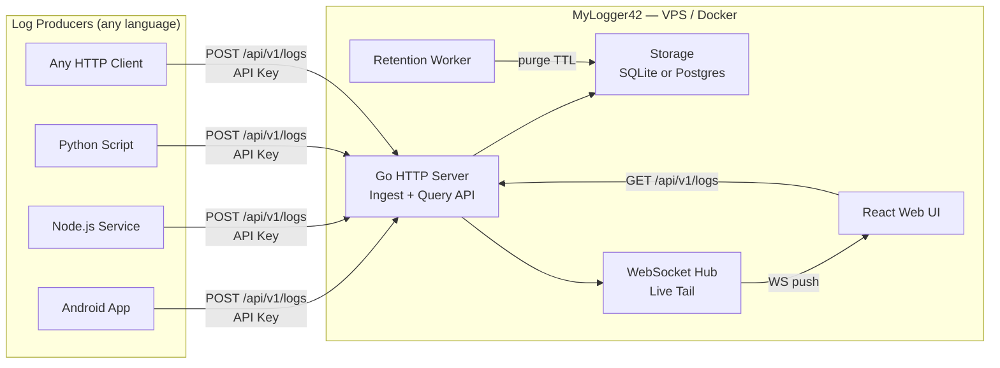

# MyLogger42 — Project Overview

## Purpose

MyLogger42 is a self-hosted event logging system for development projects. Any application — regardless of language or framework — sends structured log events over HTTP. A web UI lets the developer search, filter, and live-tail those events to understand what is happening inside their systems.

## Problem

Development projects spread across multiple languages and stacks produce log output in inconsistent ways: stdout, files, third-party SaaS. There is no single place to query "what happened in service X between 14:00 and 14:30 today" or watch events stream in real-time during debugging.

## Goals

- Accept structured log events from any HTTP client
- Store events durably with configurable retention
- Provide a web UI for search, filtering by level/service/time, and live tail
- Deploy as a single `docker compose up` on any VPS or local machine
- Remain operationally simple for a single developer — no Kafka, no Elasticsearch, no cloud dependencies

## Non-Goals

- Multi-tenant / team use (no per-user access control)
- Production observability at scale (not a replacement for Datadog, Grafana Loki, etc.)
- Log aggregation from files or syslog (HTTP ingest only)
- Alerting / PagerDuty-style notifications (v1)
- Log shipping to external sinks (v1)

## Stakeholders

| Role | Person |
|------|--------|
| Developer / Operator | Solo developer (steffen@airwallet.net) |
| Log producers | Any service under development |

## System Context

## Log Levels (Canonical)

| Level | Value | Meaning |
|-------|-------|---------|
| Verbose | 0 | Noisy detail, usually filtered in production |
| Debug | 1 | Developer-facing diagnostic information |
| Info | 2 | Normal operational events |
| Event | 3 | Discrete domain/business events (e.g. "user registered") |
| Warning | 4 | Unexpected but non-fatal condition |
| Error | 5 | Failure that requires attention |
| Fatal | 6 | System cannot continue; process exit expected |

## Technology Summary

| Concern | Choice | Rationale |
|---------|--------|-----------|
| Backend | Go | Single static binary, tiny Docker image, strong concurrency and WebSocket support |
| Storage | SQLite or Postgres | Configurable via env var — SQLite for zero-ops simplicity, Postgres for durability and concurrency |
| Frontend | React + Vite | Full SPA with real-time WebSocket live tail |
| Protocol | HTTP REST + WebSocket | Language-agnostic ingest; WebSocket for push-based live tail |
| Auth | API key (ingest only) | Simple static key in `.env`; UI open (behind reverse proxy) |
| Deployment | Docker Compose | One command, works on any Linux VPS |
