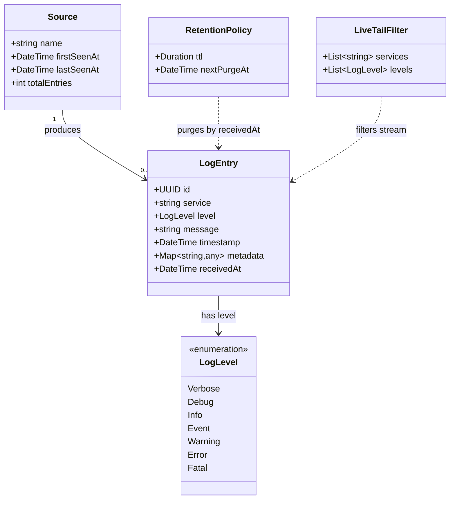

# Domain Model

## Entities and Value Objects

## Descriptions

### LogEntry
The core domain object. Represents a single discrete event emitted by a client service.

| Field | Type | Notes |
|-------|------|-------|
| `id` | UUID v4 | Generated server-side on receipt |
| `service` | string | Name of the emitting service (e.g. `"api-server"`, `"android-app"`) |
| `level` | LogLevel | One of the 7 canonical levels |
| `message` | string | Human-readable description of the event |
| `timestamp` | RFC3339 datetime | Client-supplied event time |
| `metadata` | JSON object | Arbitrary structured data (e.g. `{"userId": "abc", "requestId": "xyz"}`) |
| `receivedAt` | RFC3339 datetime | Server-assigned receipt time; used for retention and ordering when `timestamp` is skewed |

### LogLevel
Enumeration. Ordered by severity (0 = lowest, 6 = highest).

`Verbose(0) < Debug(1) < Info(2) < Event(3) < Warning(4) < Error(5) < Fatal(6)`

### Source
A read-only projection — not stored as a separate table. Derived by grouping LogEntries by `service`. The query API exposes it for the UI's service filter dropdown.

### RetentionPolicy
Value object representing the configured TTL. Defined by `RETENTION_DAYS` env var. The retention worker reads this and purges entries where `receivedAt < now - ttl`.

### LiveTailFilter
Value object held per WebSocket client. Zero-value (empty lists) means "receive all". Non-empty lists act as inclusive filters — the server only pushes entries matching all non-empty criteria.

## Invariants

- `service` is required and non-empty.
- `level` must be one of the 7 canonical values; unknown values are rejected with `400 Bad Request`.
- `timestamp` is optional — if absent, server sets it to `receivedAt`.
- `metadata` is optional — defaults to empty object `{}` if absent.
- `message` is required and non-empty.
